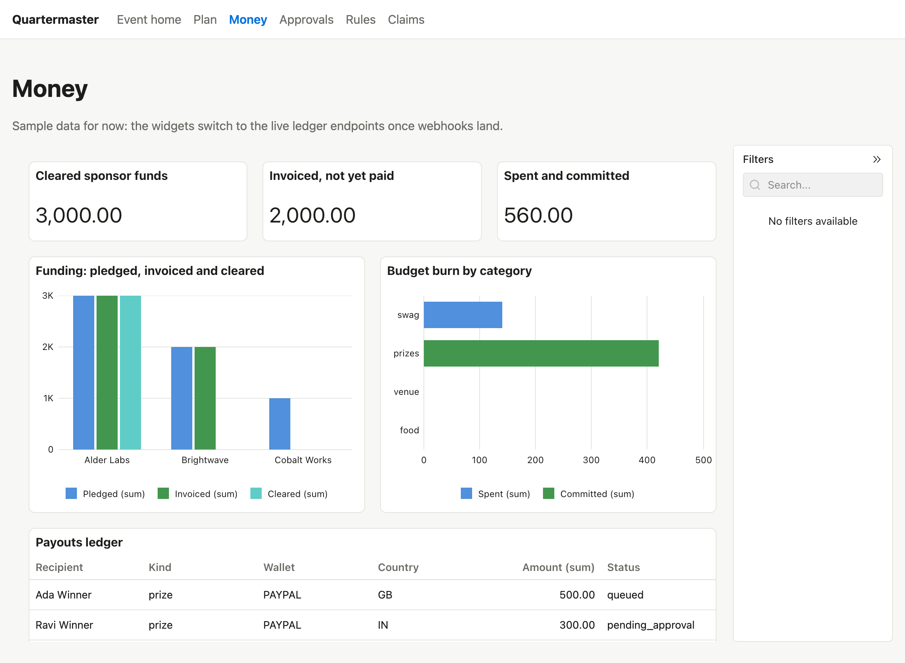

# Quartermaster

An AI operations agent for community tech events that runs all of an event's money on PayPal: sponsor money in, purchases and people payouts out, under spending rules no agent can break. Built for the PayPal AI Hackathon. Full spec: [`docs/PRD.pdf`](docs/PRD.pdf).

## Run locally

Prerequisites: Node 22 and pnpm (`corepack enable`).

```sh
pnpm install
cp .env.example .env   # fill in sandbox credentials
pnpm dev               # web on http://localhost:5173, API on http://localhost:3001
```

Other commands: `pnpm build`, `pnpm start` (serves the built web app from the API), `pnpm typecheck`, `pnpm lint`, `pnpm test`.

## Repo layout

| Path              | What                                                   |
| ----------------- | ------------------------------------------------------ |
| `apps/web`        | React + Vite front end                                 |
| `apps/api`        | Express API: agents, rules engine, PayPal webhooks     |
| `packages/shared` | API contract types and zod schemas shared by web + API |
| `render.yaml`     | Render Blueprint (web service; Postgres is Supabase)   |

## PayPal capabilities used

_TODO: list each capability with a link to its code path._

| Capability                                                                                                                                    | Code                                                                                                                                                                                                           |
| --------------------------------------------------------------------------------------------------------------------------------------------- | -------------------------------------------------------------------------------------------------------------------------------------------------------------------------------------------------------------- |
| OAuth client credentials (per app, cached token)                                                                                              | [`apps/api/src/paypal/client.ts`](apps/api/src/paypal/client.ts)                                                                                                                                               |
| Orders v2: create order, show order                                                                                                           | [`apps/api/src/paypal/orders.ts`](apps/api/src/paypal/orders.ts)                                                                                                                                               |
| Sandbox negative testing (`PayPal-Mock-Response`)                                                                                             | [`apps/api/src/paypal/client.ts`](apps/api/src/paypal/client.ts), [`apps/api/scripts/paypal-smoke.ts`](apps/api/scripts/paypal-smoke.ts) (`pnpm --filter @quartermaster/api paypal:smoke`)                     |
| Invoicing v2: create, send, show, search by reference (sponsor invoices, F4)                                                                  | [`apps/api/src/paypal/invoicing.ts`](apps/api/src/paypal/invoicing.ts), [`apps/api/src/invoices/send.ts`](apps/api/src/invoices/send.ts), [`apps/api/src/routes/invoices.ts`](apps/api/src/routes/invoices.ts) |
| Webhook events into the ledger: `INVOICING.INVOICE.PAID`, `PAYMENT.CAPTURE.COMPLETED`, `PAYMENT.CAPTURE.REFUNDED`, `PAYMENT.CAPTURE.REVERSED` | [`apps/api/src/webhooks/handlers/`](apps/api/src/webhooks/handlers/), [`apps/api/src/db/ledger.ts`](apps/api/src/db/ledger.ts)                                                                                 |
| Payouts v1: one batch to a sandbox recipient (day-1 check only; production payouts come with F17)                                             | [`apps/api/scripts/day1/payouts.ts`](apps/api/scripts/day1/payouts.ts)                                                                                                                                         |
| Transaction Search: one sandbox query (day-1 check only; reconciliation comes with F20 and F22)                                               | [`apps/api/scripts/day1/search.ts`](apps/api/scripts/day1/search.ts)                                                                                                                                           |

## Sponsor integrations

### AG Studio

The Money screen is an AG Studio command center, themed from `apps/web/src/styles/tokens.css`. Its data sources are built from the shared widget shapes (`packages/shared/src/widgets.ts`); for now they read sample data and will switch to ledger-backed API endpoints.

| What                                                        | Code                                   |
| ----------------------------------------------------------- | -------------------------------------- |
| Studio wiring, lazy-loaded                                  | `apps/web/src/money/CommandCenter.tsx` |
| Theme from design tokens                                    | `apps/web/src/money/studio-theme.ts`   |
| Data sources from the shared shapes                         | `apps/web/src/money/studio-data.ts`    |
| Default report (KPIs, funding, budget burn, payouts ledger) | `apps/web/src/money/initial-report.ts` |



Setup notes and the day-1 PayPal checks: [`docs/p3/stage-0.md`](docs/p3/stage-0.md). The licence key is read from `VITE_AG_STUDIO_LICENSE` and is not committed.

### Bryntum

_TODO (P4)_

### Channel3

_TODO (P1)_

## Agent loop (P1)

The Event home chat is a tool loop, not a single completion. An orchestrator agent writes a checklist for the organizer's goal, works through it with tools, and stops when every item is done or blocked. The checklist is saved as a mandate in Postgres (Supabase), so it survives reloads.

| Piece                                     | Code                                                                                                                                    |
| ----------------------------------------- | --------------------------------------------------------------------------------------------------------------------------------------- |
| Orchestrator (read, checklist, delegate)  | [`apps/api/src/agents/orchestrator.ts`](apps/api/src/agents/orchestrator.ts)                                                            |
| Planning subagent (its PRD §7 tools only) | [`apps/api/src/agents/planning.ts`](apps/api/src/agents/planning.ts), [`tools/`](apps/api/src/agents/tools)                             |
| Streaming chat route + rate limit         | [`apps/api/src/routes/chat.ts`](apps/api/src/routes/chat.ts)                                                                            |
| Schema, migrations, seed                  | [`apps/api/src/db/schema.ts`](apps/api/src/db/schema.ts), [`apps/api/drizzle/`](apps/api/drizzle), [`seed.ts`](apps/api/src/db/seed.ts) |
| Web chat with live checklist              | [`apps/web/src/chat/AgentChat.tsx`](apps/web/src/chat/AgentChat.tsx)                                                                    |

Setup: set `DATABASE_URL` (Supabase transaction pooler), then `pnpm --filter @quartermaster/api db:migrate && pnpm --filter @quartermaster/api db:seed`.

Safety: no agent has a money tool yet. Procurement and treasury subagents arrive with the rules engine, and every money call will pass `check()`. Every tool call writes an `audit_log` row with its input and a one-sentence reason.

Differs from the PRD: the database is Supabase Postgres instead of Render Postgres, and the orchestrator is a sixth agent (it holds no money tools). Update the PRD to match.

### Render

_TODO (P2)_

### APIMatic

We use the APIMatic Context Plugin (`context-matic@apimatic`, MCP server `context-matic`) in Claude Code to check PayPal request shapes. Only calls the plugin actually answered are listed. The PayPal client code in `apps/api/src/paypal/` was written before the plugin was running on this machine, so the entries below are a cross-check of that code, not its origin.

| Date       | Tool                               | Prompt or query                                                                                | What it returned                                                                                                                                                                                                                       | Files checked                             |
| ---------- | ---------------------------------- | ---------------------------------------------------------------------------------------------- | -------------------------------------------------------------------------------------------------------------------------------------------------------------------------------------------------------------------------------------- | ----------------------------------------- |
| 2026-10-29 | `fetch_api` (typescript, `paypal`) | `paypal`                                                                                       | One API, "PayPal Server SDK": Orders, Payments, US-only Vault, Transaction Search, Subscriptions                                                                                                                                       | n/a                                       |
| 2026-10-29 | `ask`                              | Log in with PayPal: authorization URL, code-for-token exchange, `/v1/identity/oauth2/userinfo` | **Not covered.** The SDK documents only the client-credentials grant; no Identity or userinfo endpoint                                                                                                                                 | F1 (`apps/api/src/auth/`), see note below |
| 2026-10-29 | `ask`                              | How do I create a Vault setup token for a PayPal wallet?                                       | `VaultController.createSetupToken` with `paymentSource.paypal`; SDK `@paypal/paypal-server-sdk@2.0.0`                                                                                                                                  | `apps/api/src/paypal/vault.ts`            |
| 2026-10-29 | `model_search`                     | `VaultPaypalWalletRequest`, `PaypalWalletExperienceContext`                                    | Confirms every field we send exists: `usageType`, `customerType`, `permitMultiplePaymentTokens`, `experienceContext.returnUrl/cancelUrl`, `shippingPreference`, `userAction`, `vaultId`. Optional `usagePattern` is one we do not send | `vault.ts`, `orders.ts`                   |
| 2026-10-29 | `endpoint_search`                  | `userinfo`, `RequestToken`                                                                     | No Identity endpoint. Returned unrelated Orders, Payments, Subscriptions, Transaction Search and Vault methods                                                                                                                         | n/a                                       |

Not answered (the tool returned "An error occurred invoking 'ask'"): a long multi-part Vault question, a long Orders-with-`vault_id` question, and the short `How do I create an order paid with a vaulted PayPal token (vault_id)?`. Short single-topic questions worked best.

Gap worth telling APIMatic: the plugin has no coverage of PayPal Identity (Log in with PayPal), which our F1 needs. F1 request shapes therefore come from PayPal's own developer documentation, and the code is not attributed to the plugin.

## License

MIT
