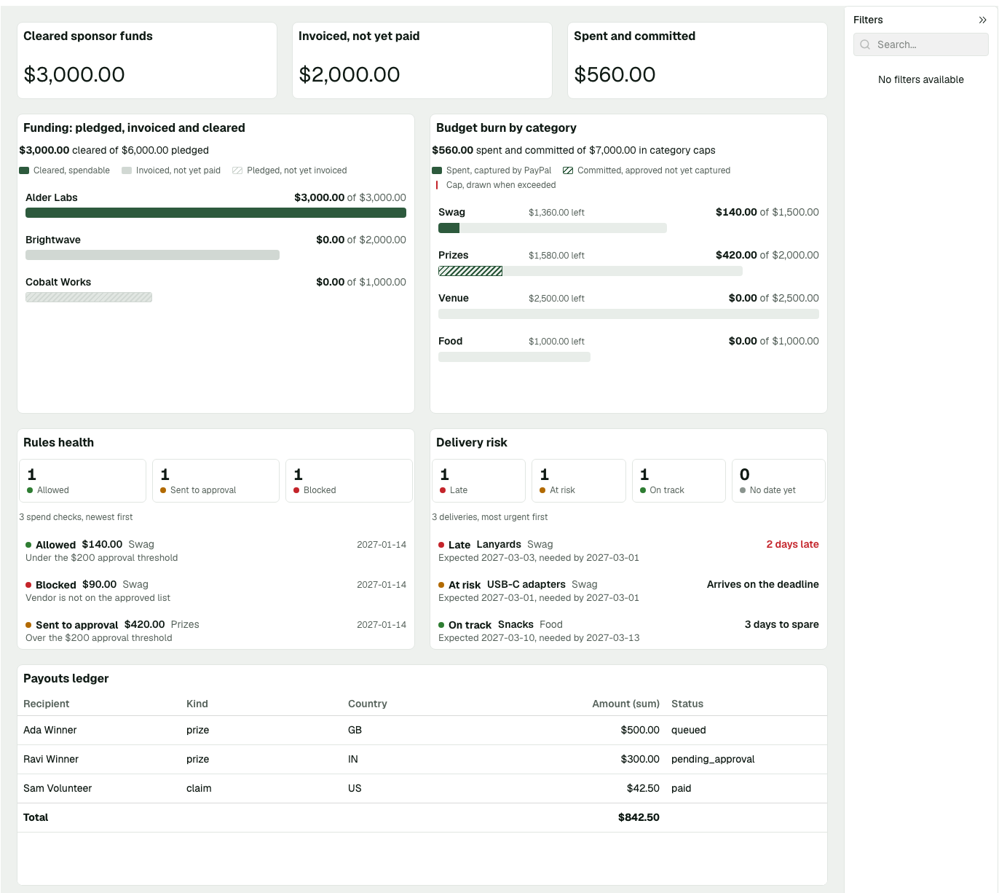
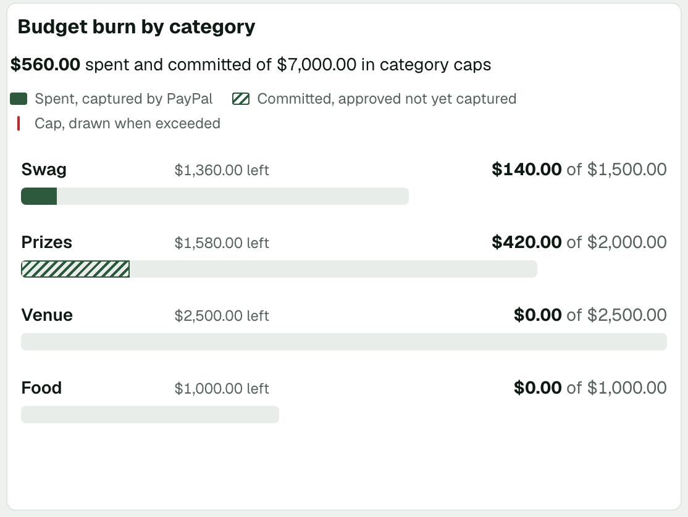
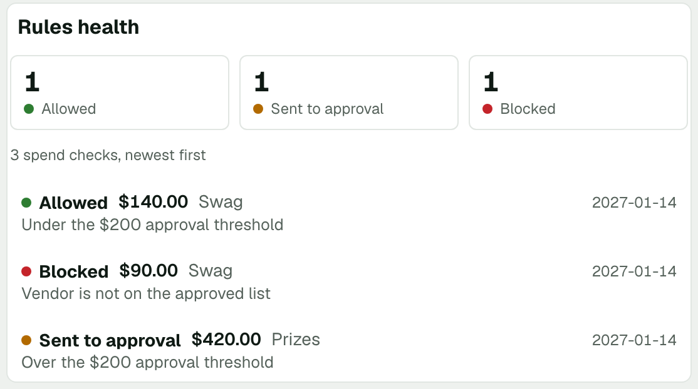
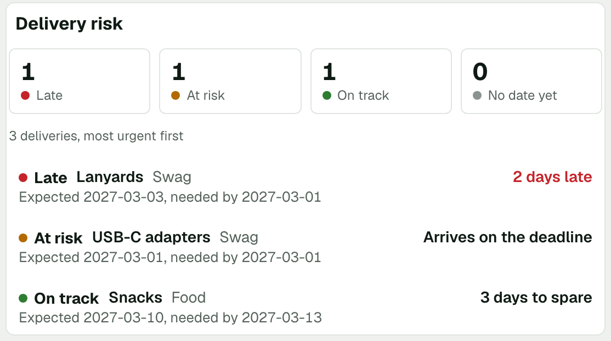
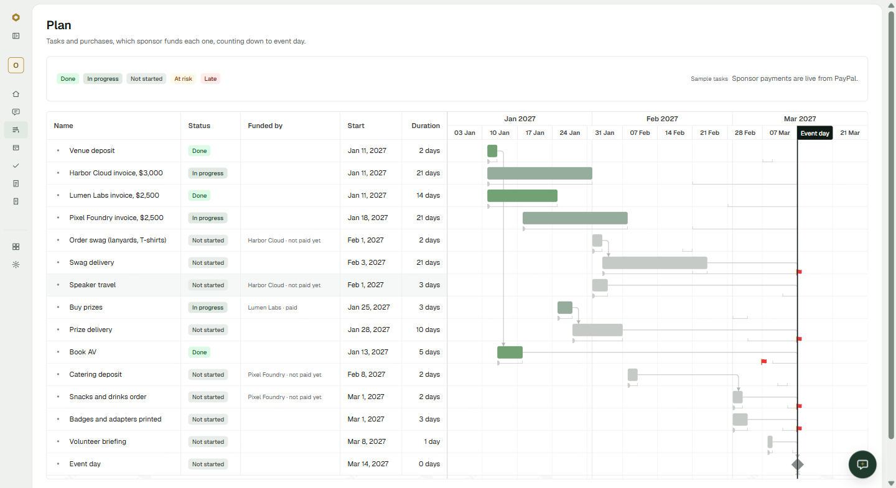

# Quartermaster

An AI operations agent for community tech events that runs all of an event's money on PayPal: sponsor money in, purchases and people payouts out, under spending rules no agent can break. Built for the PayPal AI Hackathon. Full spec: [`docs/PRD.pdf`](docs/PRD.pdf).

## Run locally

Prerequisites: Node 22 and pnpm (`corepack enable`).

```sh
pnpm install
cp .env.example .env   # fill in sandbox credentials
pnpm dev               # web on http://localhost:5173, API on http://localhost:3001
```

Other commands: `pnpm build`, `pnpm start` (serves the built web app from the API), `pnpm typecheck`, `pnpm lint`, `pnpm test`.

## Repo layout

| Path              | What                                                   |
| ----------------- | ------------------------------------------------------ |
| `apps/web`        | React + Vite front end                                 |
| `apps/api`        | Express API: agents, rules engine, PayPal webhooks     |
| `packages/shared` | API contract types and zod schemas shared by web + API |
| `render.yaml`     | Render Blueprint (web service; Postgres is Supabase)   |

## PayPal capabilities used

| Capability                                                                                                                                    | Code                                                                                                                                                                                                           |
| --------------------------------------------------------------------------------------------------------------------------------------------- | -------------------------------------------------------------------------------------------------------------------------------------------------------------------------------------------------------------- |
| OAuth client credentials (per app, cached token)                                                                                              | [`apps/api/src/paypal/client.ts`](apps/api/src/paypal/client.ts)                                                                                                                                               |
| Orders v2: create order, show order                                                                                                           | [`apps/api/src/paypal/orders.ts`](apps/api/src/paypal/orders.ts)                                                                                                                                               |
| Log in with PayPal (OpenID Connect: authorize, code exchange, userinfo) for the treasurer; only members of an allowlist get a session (F1) | [`apps/api/src/auth/`](apps/api/src/auth/), [`apps/api/src/routes/auth.ts`](apps/api/src/routes/auth.ts) |
| Vault v3: setup token, payment token for the agent wallet, and deleting the token as the kill switch (F13, F15) | [`apps/api/src/paypal/vault.ts`](apps/api/src/paypal/vault.ts), [`apps/api/src/routes/wallet.ts`](apps/api/src/routes/wallet.ts), `revokeWallet` in [`apps/api/src/payments/executor.ts`](apps/api/src/payments/executor.ts), the demo wallet pool in [`apps/api/src/payments/pool.ts`](apps/api/src/payments/pool.ts) and [`apps/api/src/routes/walletPool.ts`](apps/api/src/routes/walletPool.ts) |
| Orders v2, automatic payment: charge the saved wallet with `vault_id`, only after the rules engine says allow (F13) | [`apps/api/src/paypal/spend.ts`](apps/api/src/paypal/spend.ts) (imported only by the executor; ESLint enforces it), [`apps/api/src/payments/executor.ts`](apps/api/src/payments/executor.ts) |
| Orders v2, supervised payment: an order the treasurer approves with PayPal's button, captured only after PayPal reports it APPROVED for the exact amount (F14) | [`apps/api/src/payments/executor.ts`](apps/api/src/payments/executor.ts), [`apps/api/src/routes/approvals.ts`](apps/api/src/routes/approvals.ts), [`apps/api/src/webhooks/orderApproved.ts`](apps/api/src/webhooks/orderApproved.ts) (`CHECKOUT.ORDER.APPROVED` backup), [`apps/web/src/approvals/`](apps/web/src/approvals/) |
| Reporting: Treasury account balances for the wallet card (F2) | [`apps/api/src/paypal/balances.ts`](apps/api/src/paypal/balances.ts), [`apps/api/src/routes/treasury.ts`](apps/api/src/routes/treasury.ts) |
| Sandbox negative testing (`PayPal-Mock-Response`)                                                                                             | [`apps/api/src/paypal/client.ts`](apps/api/src/paypal/client.ts), [`apps/api/scripts/paypal-smoke.ts`](apps/api/scripts/paypal-smoke.ts) (`pnpm --filter @quartermaster/api paypal:smoke`)                     |
| Invoicing v2: create, send, show, search by reference (sponsor invoices, F4)                                                                  | [`apps/api/src/paypal/invoicing.ts`](apps/api/src/paypal/invoicing.ts), [`apps/api/src/invoices/send.ts`](apps/api/src/invoices/send.ts), [`apps/api/src/routes/invoices.ts`](apps/api/src/routes/invoices.ts) |
| Orders v2, public checkout for tickets and donations with no login (F6): the server creates and prices the order (`custom_id` carries `qm:<eventId>:ticket` or `qm:<eventId>:donation`), PayPal's JS button only approves it, the server captures it, and the `PAYMENT.CAPTURE.COMPLETED` webhook records the amount net of PayPal fees in the ledger. Proven on staging: a $25 ticket and a $10 donation both reached the ledger | [`apps/api/src/routes/checkout.ts`](apps/api/src/routes/checkout.ts), [`apps/api/src/paypal/income.ts`](apps/api/src/paypal/income.ts), [`apps/api/src/webhooks/handlers/capture-completed.ts`](apps/api/src/webhooks/handlers/capture-completed.ts), [`apps/web/src/checkout/PayButtons.tsx`](apps/web/src/checkout/PayButtons.tsx) |
| Webhook events into the ledger: `INVOICING.INVOICE.PAID`, `PAYMENT.CAPTURE.COMPLETED`, `PAYMENT.CAPTURE.REFUNDED`, `PAYMENT.CAPTURE.REVERSED` | [`apps/api/src/webhooks/handlers/`](apps/api/src/webhooks/handlers/), [`apps/api/src/db/ledger.ts`](apps/api/src/db/ledger.ts)                                                                                 |
| Payouts v1 (F16, F17): receipt claims, prizes and speaker fees, one payout per spend with our reference id as `sender_batch_id`, `sender_item_id` and `PayPal-Request-Id`, sent only by the executor after the rules engine (Treasury app) | [`apps/api/src/paypal/payouts.ts`](apps/api/src/paypal/payouts.ts), [`apps/api/src/payments/executor.ts`](apps/api/src/payments/executor.ts), [`apps/api/src/claims/service.ts`](apps/api/src/claims/service.ts), [`apps/api/src/payouts/service.ts`](apps/api/src/payouts/service.ts), [`apps/api/scripts/day1/payouts.ts`](apps/api/scripts/day1/payouts.ts) |
| Payout item webhooks: `PAYMENT.PAYOUTS-ITEM.*` (succeeded, failed, unclaimed, returned and the rest) mark each claim, prize or speaker fee paid or not, matched by `sender_item_id` (F17) | [`apps/api/src/webhooks/handlers/payout-item.ts`](apps/api/src/webhooks/handlers/payout-item.ts), [`apps/api/src/paypal/payout-status.ts`](apps/api/src/paypal/payout-status.ts) |
| Transaction Search: one sandbox query (day-1 check only; reconciliation comes with F20 and F22)                                               | [`apps/api/scripts/day1/search.ts`](apps/api/scripts/day1/search.ts)                                                                                                                                           |

## Sponsor integrations

### AG Studio

The Money screen is an AG Studio command center, themed from `apps/web/src/styles/tokens.css`. Its data sources are built from the shared widget shapes (`packages/shared/src/widgets.ts`); they are filled from the treasurer-only endpoints `GET /api/widgets/*`. The funding thermometer, budget burn and rules health are live, from the ledger, the funds-gated budget and the audit log. The payouts ledger is live too: every receipt claim, prize and speaker fee, with the status PayPal's payout item webhooks last reported. Delivery risk is labelled sample until P4's orders and tracking exist. A line above the widgets says which is which. If the endpoints cannot be reached (not signed in, no server), the page shows its own sample as a whole and says why, because live sponsor ids would not match sample rows and the cross-filtering would break.

| What                                                                          | Code                                            |
| ----------------------------------------------------------------------------- | ----------------------------------------------- |
| Studio wiring, lazy-loaded                                                    | `apps/web/src/money/CommandCenter.tsx`          |
| Theme from design tokens                                                      | `apps/web/src/money/studio-theme.ts`            |
| Data sources from the shared shapes                                           | `apps/web/src/money/studio-data.ts`             |
| Default report (KPIs, funding, budget burn, payouts ledger)                   | `apps/web/src/money/initial-report.ts`          |
| Widget endpoints, in the shared shapes                                        | `apps/api/src/routes/widgets.ts`                |
| Data hook: fetch, label the source, fall back                                 | `apps/web/src/money/use-command-center-data.ts` |
| Custom widgets: funding thermometer, budget burn, rules health, delivery risk | `apps/web/src/money/widgets/`                   |



Budget burn is a custom widget: for each budget category it shows what was spent (captured) and committed (approved, not yet captured) against the category's cap. A category over its cap says so in words and gets a line at the cap. Clicking a category cross-filters the widgets that share its table. Its numbers are live: committed spend is counted exactly as the rules check counts it, and the caps are the rules in force, so the widget and the rules agree on what is left.



Rules health is a third custom widget: how many recent spends the rules allowed, sent to the treasurer or blocked, with each check's amount, category and reasons. A check that has no reasons is labelled, and one with a decision it does not recognise is reported instead of counted.



Delivery risk is the fourth custom widget: the ordered items against their deadlines, most urgent first, with how many are late, at risk, on track or without a delivery date yet. An item with no date says so; it is never shown as arriving on its deadline.



**Cross-filtering.** A click on a sponsor or a budget category filters the widgets that list individual rows: the payouts ledger, rules health and delivery risk. The funding, budget and KPI widgets ignore other widgets' selections on purpose, because a category total is not a sponsor's and a query that joins one through the other can inflate a sum. Studio's fan-out check is set to refuse such a query (`options.fanout.execute: 'prevent'`). Studio does not tell a custom widget that the filters changed, so `CommandCenter` passes `onStateUpdated` to `apps/web/src/money/widgets/filters-changed.ts`, which makes the row-listing widgets fetch again.

The Stage 2 write-up, with how the cross-filtering works and what is still sample: [`docs/p3/stage-2.md`](docs/p3/stage-2.md). Setup notes and the day-1 PayPal checks: [`docs/p3/stage-0.md`](docs/p3/stage-0.md). The licence key is read from `VITE_AG_STUDIO_LICENSE` and is not committed.

### Receipt claims and payouts (P3)

Volunteers, speakers and winners are paid from the Treasury app with PayPal Payouts, and every payment passes the same rules engine as a purchase.

- **Receipt claims (F16).** The treasurer registers a volunteer with their PayPal email and gets a personal claim link (`/claim/:token`; only a SHA-256 hash of the token is stored). On a phone, the volunteer snaps a receipt. A model reads it into a fixed schema (merchant, date, total, currency, line items, a confidence for each), with the photo passed as data, so text on a receipt cannot change who is paid or how much. A clear reading goes to the executor as a claim: the $50 per person per day cap, the $200 approval threshold and the funds gate apply, the check is audited, and the money goes only to the registered email. A field under 0.8 confidence, a foreign currency or no total waits for the treasurer, whose confirmed amount still goes through the rules. Code: [`apps/api/src/claims/`](apps/api/src/claims/), [`apps/api/src/routes/claims.ts`](apps/api/src/routes/claims.ts), [`apps/web/src/pages/VolunteerClaim.tsx`](apps/web/src/pages/VolunteerClaim.tsx), [`apps/web/src/pages/Claims.tsx`](apps/web/src/pages/Claims.tsx).
- **Prizes and speaker fees (F17).** The Money screen's Payouts tab pays a winner or a speaker through the rules engine. Above the payout threshold it waits on the Approvals screen; a prize funded by a sponsor is not held for that sponsor's invoice (the sponsor gate is gone; the rules are the limit). Code: [`apps/api/src/payouts/service.ts`](apps/api/src/payouts/service.ts), [`apps/api/src/routes/payouts.ts`](apps/api/src/routes/payouts.ts), [`apps/web/src/money/Payouts.tsx`](apps/web/src/money/Payouts.tsx).
- **What PayPal says is the truth.** "Paid" comes only from PayPal's payout item webhooks, never from our own guess. We use the item events rather than the batch event, because a successful batch can still hold an unclaimed or returned item. An unknown status or an unknown item is written to the audit log and changes nothing.
- **Not yet shown on the sandbox.** These paths are covered by automated tests against the real executor and rules engine, with PayPal faked. A sandbox run, with the Treasury webhook subscribed to `PAYMENT.PAYOUTS-ITEM.*`, is still to come and will be added here.

### Bryntum

The Plan screen is a Bryntum Gantt (trial 7.3.7, React wrapper) in [`apps/web/src/plan/`](apps/web/src/plan/): the event's tasks and purchases on one timeline, counting down to event day.

- **Each sponsor invoice is a task, live from PayPal.** Its bar follows the sponsor's status from `GET /api/sponsors`: invoiced is in progress, and when PayPal reports the invoice paid (`INVOICING.INVOICE.PAID`) it turns done, without a reload (the screen re-reads sponsor status every 10 seconds while one is unpaid).
- **Every purchase says which sponsor funds it,** and whether that sponsor has paid yet ("Harbor Cloud · not paid yet"). It is a label, not a lock: since Nov 6 the organizer's own PayPal account pays, so a purchase never waits on a sponsor.
- **Red means a delivery problem.** At risk is two days or fewer to spare before a deadline; late is past it. Late-delivery recovery (F18/F19, next) is where the agent moves the dependent tasks.
- **Event day is a fixed milestone** (a must-start-on constraint), and each purchase with a deadline gets a deadline flag.
- **One design system.** Bars use the same status colors as every badge in the app, and the Gantt theme is driven from `apps/web/src/styles/tokens.css`.

| What                                                                                 | Code                                                                       |
| ------------------------------------------------------------------------------------ | -------------------------------------------------------------------------- |
| Gantt setup: columns (Status, Funded by), bar colors by status                       | [`apps/web/src/plan/PlanGantt.tsx`](apps/web/src/plan/PlanGantt.tsx)       |
| Sponsor labels: which sponsor funds each purchase, invoice tasks from sponsor status | [`apps/web/src/plan/gating.ts`](apps/web/src/plan/gating.ts)               |
| Live sponsor status matched to the plan                                              | [`apps/web/src/plan/sponsorSource.ts`](apps/web/src/plan/sponsorSource.ts) |
| Task model with our status and its funding sponsor                                   | [`apps/web/src/plan/PlanTask.ts`](apps/web/src/plan/PlanTask.ts)           |
| Sample OpenHack 2027 plan: 15 linked tasks, three sponsors                           | [`apps/web/src/plan/demoPlan.ts`](apps/web/src/plan/demoPlan.ts)           |
| Theme overrides from design tokens                                                   | [`apps/web/src/plan/gantt-theme.css`](apps/web/src/plan/gantt-theme.css)   |
| Plan page: legend, polling sponsor status, lazy-loading the Gantt                    | [`apps/web/src/pages/Plan.tsx`](apps/web/src/pages/Plan.tsx)               |

Lumen Labs has paid, so its invoice task is done and "Buy prizes" shows it as paid for. Harbor Cloud and Pixel Foundry are invoiced and not paid yet:



_Status: the tasks are sample data, labelled on the screen; sponsor status is live. Next: live tasks from the plan endpoint and the planning agent (F11), then tracking dates (F18) and late-delivery recovery (F19), where the agent moves dependent tasks when a delivery runs late._

### Channel3

_TODO (P1)_

## Agent loop (P1)

The Event home chat is a tool loop, not a single completion. An orchestrator agent writes a checklist for the organizer's goal, works through it with tools, and stops when every item is done or blocked. The checklist is saved as a mandate in Postgres (Supabase), so it survives reloads.

| Piece                                     | Code                                                                                                                                    |
| ----------------------------------------- | --------------------------------------------------------------------------------------------------------------------------------------- |
| Orchestrator (read, checklist, delegate)  | [`apps/api/src/agents/orchestrator.ts`](apps/api/src/agents/orchestrator.ts)                                                            |
| Planning subagent (its PRD §7 tools only) | [`apps/api/src/agents/planning.ts`](apps/api/src/agents/planning.ts), [`tools/`](apps/api/src/agents/tools)                             |
| Streaming chat route + rate limit         | [`apps/api/src/routes/chat.ts`](apps/api/src/routes/chat.ts)                                                                            |
| Schema, migrations, seed                  | [`apps/api/src/db/schema.ts`](apps/api/src/db/schema.ts), [`apps/api/drizzle/`](apps/api/drizzle), [`seed.ts`](apps/api/src/db/seed.ts) |
| Web chat with live checklist              | [`apps/web/src/chat/AgentChat.tsx`](apps/web/src/chat/AgentChat.tsx)                                                                    |

Setup: set `DATABASE_URL` (Supabase session pooler, port 5432), then `pnpm --filter @quartermaster/api db:migrate && pnpm --filter @quartermaster/api db:seed`.

Safety: no agent has a money tool yet. Procurement and treasury subagents arrive with the rules engine, and every money call will pass `check()`. Every tool call writes an `audit_log` row with its input and a one-sentence reason.

Differs from the PRD: the database is Supabase Postgres instead of Render Postgres, and the orchestrator is a sixth agent (it holds no money tools). Update the PRD to match.

### Render

The app is one Render web service: the Express API also serves the built web app, so there is a single URL. Postgres is Supabase, not Render Postgres.

- **Blueprint:** [`render.yaml`](render.yaml) declares the service (Node 22, health check `/api/health`, build with pnpm, `pnpm start`). Every secret is `sync: false`: its name is in the file and the value is entered in the Render dashboard, never committed. The same names are in [`.env.example`](.env.example).
- **Migrations:** `pnpm --filter @quartermaster/api db:migrate` runs as the pre-deploy command, so a failed migration stops the deploy before the new version takes traffic.
- **Staging:** `quartermaster-staging` deploys automatically from the `development` branch on Render's free plan (it sleeps after 15 minutes without traffic, so the first request can take about a minute). Every PayPal beat described below was rehearsed there against the PayPal sandbox. Production is a second service from `main`, to be added to this section when it is live.
- **Webhooks:** each PayPal app has its own webhook, delivered to `/api/webhooks/paypal/:app` on the service URL. Every event is verified with PayPal's `verify-webhook-signature` before any handler runs (`PAYPAL_WEBHOOK_VERIFY=true`). Handlers act on `INVOICING.INVOICE.PAID` and `PAYMENT.CAPTURE.COMPLETED` (ledger income), `PAYMENT.CAPTURE.REFUNDED` and `PAYMENT.CAPTURE.REVERSED` (income reversals), and `CHECKOUT.ORDER.APPROVED` (backup capture of a treasurer-approved order); the ledger writes are idempotent on the PayPal capture or invoice id because PayPal retries deliveries.
- **One instance only:** the funds check and the spend it writes are serialized in-process, so the service must not be scaled past one instance.
- **Render Workflows (beta):** a separate Workflow service runs the background jobs in [`apps/workflows`](apps/workflows/). `budget-recompute` lists the events and runs `recompute-event` for each one in parallel, each retried up to three times. The work itself happens in the API's `/api/jobs/*` endpoints, behind a secret of their own, so the audit log and the ledger stay in one place and a task holds no PayPal credentials. A treasurer starts it by hand with `POST /api/workflows/budget-recompute/run` ([`apps/api/src/routes/workflows.ts`](apps/api/src/routes/workflows.ts)). Proven on staging on Nov 5: one run recomputed five events in parallel and wrote five `workflow.budget_recompute` audit rows plus one `workflow.trigger` row; for the demo event it found $3,023.85 cleared, $1,400.00 committed and $1,623.85 unlocked. The recompute is a snapshot, since the unlocked budget is derived from the ledger on every read. `invoice-reminders` works the same way: it lists the sponsors whose invoice is out and unpaid, then runs `remind-sponsor` for each in parallel. For each one the API asks PayPal for the live invoice status and only then asks PayPal to email a reminder (`POST /v2/invoicing/invoices/{id}/remind`), so a sponsor who has just paid is never nagged, and a sponsor is reminded at most once per 24 hours ([`apps/api/src/invoices/remind.ts`](apps/api/src/invoices/remind.ts)). Start it with `POST /api/workflows/invoice-reminders/run`. Proven on staging on Nov 5: a sandbox invoice for the bronze sponsor ($2,500) was sent, one run reminded that sponsor, and the audit log shows `invoice.create`, `invoice.sent`, `workflow.trigger` and `invoice.reminder` for the same PayPal invoice. `sponsor-reports` builds each paying sponsor's spend report (F22): it lists the sponsors that have paid and runs `report-sponsor` for each in parallel ([`apps/api/src/reports/`](apps/api/src/reports/)). The numbers are computed by code from the ledger and the executor's records, never by a model: a spend funded by one sponsor counts in full for that sponsor, and every other spend is paid from the pooled cleared income, each source paying its proportional share (cents split by the largest-remainder method), so a sponsor is never attributed more than it paid in. A model may only phrase a short summary from those figures: its output is held to plain text with no links or addresses and no number that was not supplied, otherwise a template is used, and the page says when an AI wrote it. Payments to people appear only inside category totals, never by name. The report is published at a stable, unguessable link read by the public `/report/:shareToken` page, and the treasurer gets the link from `GET /api/reports/link/:sponsorId`. Start it with `POST /api/workflows/sponsor-reports/run`. Proven on staging on Nov 5: one run published Harbor Cloud's report ($3,000.00 received; $1,384.67 attributed across four purchases, checked by hand against the ledger: its $3,000.00 is 98.9% of the event's $3,033.21 cleared income, and 98.9% of the $1,400.00 spent is $1,384.67), the public page rendered it with each purchase's PayPal ID, and the AI summary passed the output checks. The figures come from the ledger and the executor's records, and each purchase is then checked against PayPal's own transaction records with Transaction Search ([`apps/api/src/paypal/search.ts`](apps/api/src/paypal/search.ts), [`apps/api/src/reports/crosscheck.ts`](apps/api/src/reports/crosscheck.ts)): it is "confirmed" only when PayPal lists a successful payment of exactly that amount and nothing tied to it took money back (a refund or reversal makes it "differs"), and "not in PayPal's records yet" is not an accusation, because Transaction Search can take about three hours to list a payment. The check found a real mismatch on its first live run: three approved purchases were stored under their order id while PayPal lists the capture id, so the report now shows and checks the capture id the executor recorded when the approval was captured. After that fix a rerun on staging confirmed all four of Harbor Cloud's purchases against PayPal (`paypalCheck` 4 confirmed, 0 differ, 0 not found). The other jobs in the PRD (delivery check, payout batch) are not built yet: the delivery check has no tracking data to read, and the payout batch waits on the claims code.
- **Demo wallet pool:** the hosted demo is shared, and a reset must not need a person to log in to PayPal each time. So a few wallet tokens are approved ahead of time (`POST /api/wallet/pool/fill` makes the approval links, with `permit_multiple_payment_tokens: true`) and kept on standby in the `demo_token_pool` table. A standby token is never charged: the only way one becomes the agent's wallet is `POST /api/wallet/pool/reset`, a treasurer action, which first runs the normal kill switch (deletes the current token at PayPal) and then activates the oldest standby token in one transaction. With an empty pool, reset refuses and changes nothing. `POST /api/wallet/pool/end` deletes every standby token at PayPal when the demo is over. The normal connect flow is unchanged (one token per payer), and the standby tokens are the one place a token exists that the kill switch of the active wallet does not delete, which is why `end` exists. Proven on staging on Nov 5: three links were approved as the sandbox Personal account and became three standby tokens; reset activated the first; a second reset deleted that token at PayPal (404 on a direct read afterwards), activated the next, and the last standby token still existed at PayPal; the audit log shows `wallet.revoke` and `wallet.pool_reset`. PayPal gave each approved link its own token with its own customer id.
- **Demo switches are off by default:** `DEMO_LOGIN` (one-click treasurer session for judges without PayPal access) and `DEMO_SPEND` (a sandbox spend button for rehearsals). In production `DEMO_LOGIN` needs a second flag, `DEMO_LOGIN_ALLOW_PRODUCTION`, and the server logs a loud warning while it is on.

What was proven on staging with the real sandbox: a $140 swag spend paid automatically from the saved wallet; a $420 spend stopped for approval and was captured after the treasurer approved it in PayPal's popup; after the kill switch deleted the vault token, a further spend was refused and PayPal itself answered `404 TOKEN_NOT_FOUND` for the deleted token. The rules in that run are a hard-coded list ([`apps/api/src/rules/demoRules.ts`](apps/api/src/rules/demoRules.ts)); the rules compiler (F8) is not built yet.

### APIMatic

We use the APIMatic Context Plugin (`context-matic@apimatic`, MCP server `context-matic`) in Claude Code to check PayPal request shapes. Only calls the plugin actually answered are listed. The PayPal client code in `apps/api/src/paypal/` was written before the plugin was running on this machine, so the entries below are a cross-check of that code, not its origin.

| Date       | Tool                               | Prompt or query                                                                                | What it returned                                                                                                                                                                                                                                                                                                                                                                                                                                                                                                                                                                                                                               | Files checked                               |
| ---------- | ---------------------------------- | ---------------------------------------------------------------------------------------------- | ---------------------------------------------------------------------------------------------------------------------------------------------------------------------------------------------------------------------------------------------------------------------------------------------------------------------------------------------------------------------------------------------------------------------------------------------------------------------------------------------------------------------------------------------------------------------------------------------------------------------------------------------- | ------------------------------------------- |
| 2026-10-29 | `fetch_api` (typescript, `paypal`) | `paypal`                                                                                       | One API, "PayPal Server SDK": Orders, Payments, US-only Vault, Transaction Search, Subscriptions                                                                                                                                                                                                                                                                                                                                                                                                                                                                                                                                               | n/a                                         |
| 2026-10-29 | `ask`                              | Log in with PayPal: authorization URL, code-for-token exchange, `/v1/identity/oauth2/userinfo` | **Not covered.** The SDK documents only the client-credentials grant; no Identity or userinfo endpoint                                                                                                                                                                                                                                                                                                                                                                                                                                                                                                                                         | F1 (`apps/api/src/auth/`), see note below   |
| 2026-10-29 | `ask`                              | How do I create a Vault setup token for a PayPal wallet?                                       | `VaultController.createSetupToken` with `paymentSource.paypal`; SDK `@paypal/paypal-server-sdk@2.0.0`                                                                                                                                                                                                                                                                                                                                                                                                                                                                                                                                          | `apps/api/src/paypal/vault.ts`              |
| 2026-10-29 | `model_search`                     | `VaultPaypalWalletRequest`, `PaypalWalletExperienceContext`                                    | Confirms every field we send exists: `usageType`, `customerType`, `permitMultiplePaymentTokens`, `experienceContext.returnUrl/cancelUrl`, `shippingPreference`, `userAction`, `vaultId`. Optional `usagePattern` is one we do not send                                                                                                                                                                                                                                                                                                                                                                                                         | `vault.ts`, `orders.ts`                     |
| 2026-10-29 | `endpoint_search`                  | `userinfo`, `RequestToken`                                                                     | No Identity endpoint. Returned unrelated Orders, Payments, Subscriptions, Transaction Search and Vault methods                                                                                                                                                                                                                                                                                                                                                                                                                                                                                                                                 | n/a                                         |
| 2026-11-01 | `model_search`                     | `PurchaseUnitRequest`                                                                          | Which order field can carry our event id. `customId` is the "API caller-provided external ID… used to reconcile transactions… appears in transaction and settlement reports"; `referenceId` is the purchase unit's id (ours already); `invoiceId` must be unique per merchant account. Decision: the event id goes in `custom_id`. The related `Order.links` text also says an order opened without the PayPal button needs a `return_url`, or the payer sees an error page after approving; this matches the loop we saw on a manually opened approval link (not yet proven to be the cause); the Approvals page uses PayPal's button instead | `apps/api/src/paypal/orders.ts`, `spend.ts` |
| 2026-11-02 | `ask` | How do I create an order with intent CAPTURE for a buyer who approves with the PayPal JS SDK button, with purchase_units custom_id and a fixed amount, and then capture it from the server? | `OrdersController.createOrder` with `intent: CheckoutPaymentIntent.Capture` and `purchaseUnits[].customId` + `amount`; return the order id to the PayPal JS SDK button; after the buyer approves, call `OrdersController.captureOrder` with the same order id. Confirms the F6 flow: the server creates (and prices) the order, the button only approves it, the server captures | `apps/api/src/routes/checkout.ts`, `apps/api/src/paypal/income.ts`, `apps/web/src/checkout/PayButtons.tsx` |
| 2026-11-02 | `model_search` | `PurchaseUnitRequest` (again, for F6) | Same finding as 2026-11-01: `customId` carries our `qm:<eventId>:ticket` or `qm:<eventId>:donation` tag and is returned on the order and its capture, so the webhook can credit the right event. `amount` must be positive | `apps/api/src/paypal/orders.ts`, `apps/api/src/routes/checkout.ts` |
| 2026-11-05 | `ask` | What does permit_multiple_payment_tokens do when creating a vault setup token? | When `true`, PayPal can create multiple payment tokens for the same payer and merchant or platform combination, including separate tokens for different customers who share one PayPal account. It lives on the PayPal wallet request of `CreateSetupToken` (`VaultPaypalWalletRequest`). Matches what we saw at PayPal: two approvals by one payer gave two live tokens with different customer ids, and deleting one left the other alive | `apps/api/src/paypal/vault.ts` (`permitMultipleTokens`), `apps/api/src/routes/walletPool.ts` |
| 2026-11-05 | `endpoint_search` | `getPaymentToken` | `VaultController.getPaymentToken(id)`: reads one payment token; 404 when it does not exist, 403 without permission. This is the read we use to confirm that a deleted token is gone and a standby token still exists (`GET /v3/vault/payment-tokens/{id}`) | the pool checks in the Nov 5 staging run (a throwaway script, not committed) |
| 2026-11-05 | `endpoint_search` | `SearchTransactions` | `TransactionSearchController.searchTransactions`: `GET /v1/reporting/transactions` with `start_date` and `end_date` (RFC 3339 with seconds; at most 31 days apart), optional `transaction_id`, `fields` (`transaction_info` returns only the transaction details), `balance_affecting_records_only`, `page_size` and `page`. It also says a transaction takes up to three hours to appear, which is why the report words a missing record as "not in PayPal's records yet" | `apps/api/src/paypal/search.ts`, `apps/api/src/reports/crosscheck.ts` |
| 2026-11-05 | `model_search` | `TransactionInformation` | The fields of one listed transaction: `transactionId`, `paypalReferenceId` (the related base id), `transactionStatus` (`S` success, `P` pending, `D` denied, `V` reversed or refunded in full), `transactionAmount` and `feeAmount` as money. We read the id, the reference id, the status and the gross amount | `apps/api/src/paypal/search.ts` |

Not answered (the tool returned "An error occurred invoking 'ask'"): a long multi-part Vault question, a long Orders-with-`vault_id` question, and the short `How do I create an order paid with a vaulted PayPal token (vault_id)?`. Short single-topic questions worked best.

Gap worth telling APIMatic: the plugin has no coverage of PayPal Identity (Log in with PayPal), which our F1 needs. F1 request shapes therefore come from PayPal's own developer documentation, and the code is not attributed to the plugin.

## License

MIT
